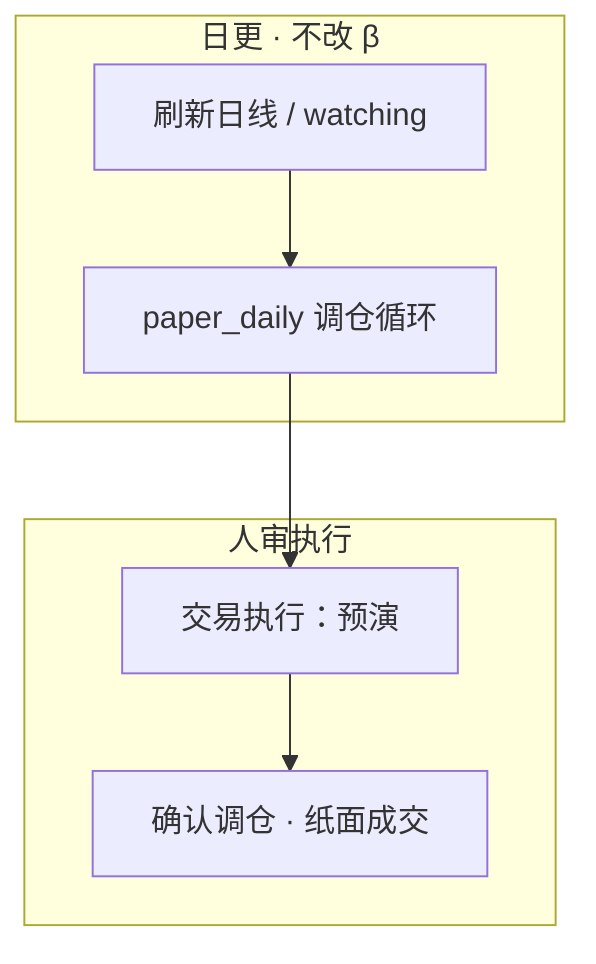

# 量化原理与实现逻辑

[← 文档索引](README.md) · **产品主轴**见 [design-spine.md](design-spine.md) · 入门名词见 **[§ 量化入门概念](#量化入门概念)** · **Web**见 [quant-ui.md](quant-ui.md) · **运维**见 [quant-ops.md](quant-ops.md) · 分层见 [architecture.md](architecture.md)

**本文职责**：ŷ / stance / 回测–纸面**契约真源**（训练 → 打分 → 回测 → 纸面）。数字由确定性 Python 计算；LLM 只解读 JSON，**不得改写** `score` / `stance_label`。

产品叙事（因果链 · 北极星 · N 轨）以 [design-spine.md](design-spine.md) 为准；调仓/做 T 产品规则见 [rebalance-logic.md](rebalance-logic.md) · [t0-logic.md](t0-logic.md)。手把手跑通见 [getting-started.md](getting-started.md)。

定位 = **策略验证**（研究台 + 模拟账户）；**现行不接券商 OMS**。边界见 [design-spine · 产品边界](design-spine.md#产品边界现行)。

---

### 总体架构：AI 编排层 vs 量化主轴

```text
┌─────────────────────────────────────────────────────────┐
│  AI 编排层（旁路：Agent 选工具 / 解释 facts）              │
│  · 「是否买入」须逐字引用 advise.stance_label             │
├─────────────────────────────────────────────────────────┤
│  量化主轴（core/signal · backtest · paper · research）   │
│  score_bars → sub_scores / hard_reject                   │
│  ReturnScoreModel → predicted_score（ŷ 真源）            │
│  compute_buy_stance → 买/观望/试探（规则唯一结论）         │
│  paper_replay / rank_lots · paper 账本 · store 日线缓存  │
└─────────────────────────────────────────────────────────┘
```

live 信号、`backtest`、模拟账本共用 `score_bars()`（`core/signal/scorer.py`）；`stance` 是分数之上的第二层规则；LLM **不在**数值计算链中。

### 层速查（细节外链）

| 层 | 职责 | 入口 | 详见 |
|----|------|------|------|
| 1 · 因子 | `score_bars` → sub_scores · hard_reject | `core/signal/scorer.py` · Skill `signal` | 下文 score 用途 · [component/strategy.md](component/strategy.md) |
| 2 · stance | `compute_buy_stance` → `stance_label` | `core/stance.py` · Skill `advise` | [architecture · 策略层](component/strategy.md) |
| 3 · 回测 | Walk-forward / `paper_replay` · rank_lots | `core/backtest/` | [§ ŷ 回测链](#5-回测链paper_replay--rank_lots) · [rebalance-logic.md](rebalance-logic.md) |
| 4 · 纸面 | 模拟账本 · 调仓 · 做 T | `core/paper/` · `core/t0/` | [§ 策略调仓 vs 底仓做 T](#策略调仓-vs-底仓做-t) · [t0-logic.md](t0-logic.md) |
| 5 · 数据 | 日线/分钟缓存 · Feature Lake | `core/store` · `core/data` | [component/data.md](component/data.md) · [internal/feature-lake-daycube.md](internal/feature-lake-daycube.md) |

<a id="第二层买卖-stancecomputebuystance-advise"></a>
<a id="第三层历史回测walkforward"></a>

#### score 的用途

`score` / `predicted_score` 是短线动能或收益分；**不是**「会不会涨」的概率，也 **不是** 最终买卖指令。

| 用途 | 模块 | 作用 |
|------|------|------|
| **观察池排序** | `signal` · `rank_candidates` | 过滤 `hard_reject` 与低分（默认 `min_score≥55`），按 score 降序取 Top N |
| **stance 初档** | `compute_buy_stance` | score 区间映射 avoid / wait / probe / buy_light，再经 K 线/peer/index 降档 |
| **回测入场** | `backtest_signal_on_bars` | `score≥min_score` 且非 hard_reject → 模拟买入持有 |
| **纸面跟单** | `core/paper/` · `simulate_buys` | 观察池项 score 达门槛才纸面买入 |
| **横截面 / 组合** | `cross_section` · 组合回测 | 多股同日比相对强弱；产品调仓主路径为 **rank_lots + y_oo_fuse** |
| **研究** | IC 面板 · `score_buckets` | 评估 score 与未来收益关系、分层胜率 |

**不是**：买入 guarantee；LLM 可改写数字；单票绝对真理（截面看 **相对排序**）。硬拒绝条件与因子加权见 `data/signal_config.json` / `core/signal/factors/*`。

#### 选股真源：线性回归因子系数

**人工预定的规则分退出；全面拥抱数据驱动的回归模型。** 现阶段用 **线性回归（OLS / 可选 Ridge）**；线性系数 β 即 **可正可负的系数权重**。

```text
score_bars → sub_scores（特征）
ŷ = α + Σ βᵢ · zᵢ     # ReturnScoreModel → predicted_score = 选股真源
```

训练 / 打分 / 回测 / 纸面口径见 **[§ predicted_score（ŷ）全链路](#predictedscoreŷ全链路)**。

| 层级 | 现在是什么 | 不是什么 |
|------|------------|----------|
| **score** | 组/全局 `ReturnScoreModel` 的 ŷ（`predicted_score`） | 人工 `weights` 加权的规则综合分 |
| **因子系数 β** | z 上 ŷ% 斜率，**可正可负** | 和为 1 的非负混合权 |
| **stance** | 仍基于分数阈值 / 策略层 | 分类器直接输出「买/卖」 |
| **promote** | 人审冻结 `return_model`；**不**自动写 `signal_config.weights` | 静默 overwrite 生产配置 |

`score_bars` 只算因子与 `sub_scores`（ŷ 输入）及硬门禁；无模型时主字段 `score` 为空。复杂模型须 eval 证明增量后人审。演进：`线性回归 ŷ → GBDT blend → 序列模型`。

#### 工业常见因子分类（对照本仓库）

工业把 **alpha** 与 **risk（Barra 风格）** 分开；**候选因子数百**～数千，生产 alpha 常见 **几十级**。本仓库固定 registry 白名单（约 20）+ 配置权重；`factor_ols` / IC 仅研究对比，不自动扩库。

| 类别 | 工业常见示例 | 本项目 |
|------|-------------|--------|
| 价量 / 微观结构 | 换手、Amihud、订单不平衡 | `volume_price`、`liquidity`、`amihud`；`money_flow`（OHLCV proxy） |
| 动量 / 趋势 | 1/3/12 月收益、均线斜率 | `momentum`、`ma_slope`、`technical_pattern`、`weekly_confirm`、`idio_momentum` |
| 反转 | 短期 / 隔夜反转 | `reversal`、`gap_risk` |
| 波动 / 风险 | 历史波动、Beta、ATR | `volatility` |
| 基本面价值 | EP/BP/CFP | `value`、`earnings_yield`（PIT `as_of` 可用） |
| 基本面质量 / 成长 | ROE、增速 | `quality`、`growth`、`dividend`、`size` |
| 另类 / 事件 | 舆情、ESG | `alt_sentiment`（标题词表；小权重）；调仓仅表列标签、不改 fuse/rank |
| 风险模型（Barra） | 行业/风格暴露 | 横截面 **z-score** + **industry/size residual**（默认开） |

```bash
# Agent / quant(task=factor_ols)
```

<a id="机器学习视角如何理解量化"></a>
<a id="四件套对照"></a>

### 机器学习视角（摘要）

量化 ≈ 有监督 / 排序学习：因子 = 特征，ŷ = 模型输出，回测 = 带时间约束的 offline eval，纸面 = shadow deployment。

| ML 概念 | 本项目 |
|---------|--------|
| 样本 (code, date) | 日线 bar / watching 截面 |
| 特征 X | `sub_scores` · `z_oo_*` · `raw_aoo_*` 等 |
| 标签 y | `open[T+1]/open[T]-1`（ŷ_oo）；τ→close（ŷ_τc） |
| 模型 f | `ReturnScoreModel` / Ridge · LambdaRank · τ 头 |
| 评估 | IC / IR · OOS · paper_replay · 纸面净值 |
| 决策层 | `hard_reject` · `compute_buy_stance` · rank_lots 闸 |

心智三句：① 因子=特征、score=ŷ、回测=offline eval；② 横截面中性化学相对排序；③ IC/OOS/纸面对抗过拟合与非平稳。Policy/Reward 映射见 [component/rl.md](component/rl.md)。

#### 策略调仓 vs 底仓做 T

**一句话**：**调仓决定「持有什么」；做 T 决定在既有底仓上今天要不要用波动做往返。**

| 维度 | 策略调仓 | 底仓做 T |
|------|----------|----------|
| 层级 | 组合结构 · rank_lots | Overlay · 不改选股主线 |
| 信号 | **y_oo_fuse** 入场 + **y_oo_rank** 买序 + τ 闸 | **纯 ŷ_τw** 选向/金额 |
| 频率 | 日 / 开盘窗 | 每 5m 至截止钟 |
| 验证 | 持仓结构是否合理 | 既定底仓上 timing 是否增强 |

**ŷ_τ 模型共用、决策不重复**：调仓侧为买入闸 / fuse 成分；做 T 侧为 ŷ_τ*→ŷ_τw 选腿。细则见 [rebalance-logic.md](rebalance-logic.md) · [t0-logic.md](t0-logic.md) · [§2.5](#25-双层-predictedscoreŷoo-ŷτ)。

实现：`core/execution.resolve_effective_execution` · `run_daily_cycle` / `POST /api/paper/run` · `core/t0/` · Web 规则在 `/replay`、落账在 `/follow`。纸面 `simulate_buys` / 建仓预演 `plan_buy_codes` 见 `core/paper/`。

### 代码模块索引

| 职责 | 路径 |
|------|------|
| 因子打分 | `core/signal/scorer.py` — `score_bars` |
| 单票 / 截面 | `score_stock.py` · `cross_section_batch.py` · `core/signal_service.py` |
| stance / advise | `core/stance.py` · `core/advise.py` |
| 纸面 / 调仓 | `core/paper/` · `core/paper/rebalance/` |
| 做 T | `core/t0/` |
| 回测 | `core/backtest/paper_replay.py` · `engine.py` |
| ŷ 头训练 | `oo_ridge_compact` · `tc_ridge` · `oo_rank_*` · `horizon_*` |
| 报告导出预览 | `quant/services/quant_report_export.py` |
| 规则 / LLM 解读 | `quant/services/quant_interpret.py` — `offline: true` → `source=rule_based` |
| 日更 / 运维 | `core/platform/schedule_jobs.py` · [quant-ops.md](quant-ops.md) |

### 回测成本 / 撮合脚注

| 项 | 本仓库 | 边界 |
|----|--------|------|
| 佣金+印花 | `simple_cn`（默认） | 非券商实时表 |
| 冲击 | 成交额/日均额近似 bps | 非盘口模型 |
| 撮合 | T+1 · 涨跌停近似 | **非**交易所引擎 |
| 回测–纸面 | `fit_gap` + Corr/TE | 需日更样本 |

<a id="与专业量化系统的差距"></a>

### 与专业量化系统的差距（摘要）

完整北极星与能力地图见 [design-spine](design-spine.md#产品北极星)。本仓库：规则+线性 ŷ + 纸面；专业栈：大规模因子库 / QP / OMS。风控见 [component/risk.md](component/risk.md)。

<a id="量化运维"></a>

### 量化运维（摘要）

preset（`advisor` / `quant` / `quant_paper` / `full`）、cron / launchd、报告归档、watching 文件 API、信号配置只读与 diff 导出 → **全文见 [quant-ops.md](quant-ops.md)**。日更**不改 β**；改模型须人审启用。

---

## 量化入门概念

[← 文档索引](README.md) · 操作步骤见 [getting-started.md](getting-started.md) · [quant-ui.md](quant-ui.md) · 产品主轴 [design-spine.md](design-spine.md)

**产品聚焦**：观察（长期名单）· 模拟（假钱）· 回溯（历史验证）。本质见 [design-spine · 因果链](design-spine.md#因果链已发生-影响估计-动作)。

### 主线

```text
观察 + 对话 → 回溯（历史）∥ 模拟（纸面） ← 两种验证
```

| 页 | 回答什么 |
|----|----------|
| `/watching` 观察 | 长期看哪些；**建仓入口** |
| `/follow` 交易执行 | 已有仓管理 · 调仓/做 T 落账 |
| `/replay` 历史回测 | rank_lots / 做 T 历史卷 |
| `/quant` 研究枢纽 | 拟合 ŷ · 分档 · 落地 |
| `/dashboard` | 开盘态势（`/` 重定向至此） |

### 回溯 ≠ 模拟

| | 回溯 | 模拟 |
|--|------|------|
| 时间 | 历史一次推演 | 活着的假账本 |
| 模型默认 | **研究套** | **执行套**（研究槽晋级） |
| 要 `paper.json`？ | **否** | **是** |

### 五类测试（何时要纸面）

| # | 类型 | 要资金模拟？ | 要 `paper.json`？ |
|---|------|--------------|-------------------|
| 1 | 逻辑与信号 | 否 | 否 |
| 2 | 历史回测 | 是（引擎内） | **否** |
| 3 | 模拟盘 | 是 | **是** |
| 4 | 压力 / MC | 可选 | 否（远期） |
| 5 | 实盘 | 真实资金 | 否 · **现行不做 N6** |

### 边界：不强因子

当前以短线技术面 + 轻量基本面为主；`news` 对话解读，调仓表列可写 **news.db 标签**（不进 ŷ，不改 fuse/rank）。不把「涨跌归因完整」当近期目标。

操作入门：[getting-started.md](getting-started.md) · [quant-ui · 操作流程](quant-ui.md#操作流程照着做)。

---

---

## predicted_score（ŷ）全链路

[← 文档索引](README.md) · 产品主轴 [design-spine.md](design-spine.md) · 运维 [quant-ops.md](quant-ops.md) · **Live 旁路** [§ Live 出分与旁路](#live-出分与旁路) · **τ 契约** [§2.5](#25-双层-predictedscoreŷoo-ŷτ)

本文梳理 **训练 → 打分 → 回测 / 验证 → 纸面执行** 的同一套时间口径与产物流转。  
目标：任何人看到页面上的「评分 / score / ŷ」，都能回答「它在预测什么、该和谁对账、会不会自动改 β」。

> **实时 / 主题日**：ŷ_oo 主轴不变；开盘缺口与盘中头见 [§ Live 出分与旁路](#live-出分与旁路) · [§2.5](#25-双层-predictedscoreŷoo-ŷτ)。  
> **双层 predicted_score**：日线 ŷ_oo + 当日 ŷ_τ 并存、分标签对账、决策层融合；见 **§2.5**。  
> **契约缺口**：现网 = ŷ_oo 选股 + 卖出保护；完整「给定 τ → ℱ_τ → ŷ(τ)」仍按 §2.5 阶梯推进。

---

## 1. 一句话主轴

```text
【层 1 · ŷ_oo】历史日线（X 到 T−1 收；T 开可进 quote）→ `z_oo_*`∪**`raw_aoo_*` 全量**（~206）→ y_oo / predicted_score；面板仍写裸名
         → 预测 open[T+1]/open[T]−1（现网 h=1）→ **入池地板 + 主字段**；收盘后 eod_next 排序
         → aoo_core=GAP+YK+LAG 仅作消融对照（``ridge_core_only=True``）

【层 2 · ŷ_τc】alpha_τc := z_τc_*（开盘 + ≤τ 分钟 Z）∪ alpha_tc（raw_atc_*）→ y_τc
         → 预测 close[T]/price(τ)−1 → 调仓 y_oo_fuse 的 τc 项
         τ=open 时 price(τ)=open，等于 close/open−1
         **分工**：ŷ_oo 吃 z_oo_*∪raw_aoo_*；ŷ_τc 吃 raw_atc_*（τ 锚）+ z_τc_*

【层 2b · ŷ_τ*】alpha_τh := z_τh_* ∪ raw_ath_* → y_τ30…90 = P(窗收益>0)
         → 进 ŷ_τw 投票；不进 fuse。轻量 GAP/YK + 短窗升格 + 本头 H_*
```

**现网分工（勿把「真源」理解成「唯一排序键」）**

| 角色 | 现网 | 不是 |
|------|------|------|
| 主字段 `predicted_score` / 入池地板 | **ŷ_oo**（组 β）；`scoring.min_predicted_score` | `rank.min_score=55`（启发式遗留，不进 ŷ 买入门） |
| 盘中簿排序 `ŷ_trade` | `dual_score` blend：现网 **`w_oo=0, w_tau=1`** → 缺口∘ŷ_τ；收盘 `eod_next` 回到 ŷ_oo | 与调仓 rank_lots 不是同一套权 |
| 调仓 / 纸面 y_oo_fuse（UI fuse） | `fusion_w_oo` / `fusion_w_oc`（回测表单默认 0.6 / 0.4；live Follow 单条滑条，改启动时间建议 0.9/0.1 或 0.1/0.9） | `dual_score.w_*` |

层 2 **不得**覆盖层 1 字段且不改标签混对账。

---

## 2. 统一契约（全链路共用）

### 2.1 决策日 `as_of` / \(t\)

站在交易日 \(t\) 打分时：只用 **\(t\) 及以前** 已完成的日线（及 PIT 财务等）算因子。  
\(t\) 日盘中若尚无当日完整 K 线，实际因子截止日通常是 **上一交易日 \(t-1\)**。

### 2.2 标签 \(y\)（训练与验证同一公式）

\[
y_{\mathrm{oo}} = \bigl(\mathrm{open}[t+h] / \mathrm{open}[t] - 1\bigr) \times 100
\]

| 符号 | 含义 |
|------|------|
| \(t\) | 决策日（ŷ_oo 的 T；因子截止 T−1 收） |
| \(h\) | `horizon_days`（前瞻，交易日数；现网 1） |
| \(y_{\mathrm{oo}}\) | 从 T 开到 T+h 开的简单收益（百分点） |

实现：`core/research/oo_panel.py`（矩阵堆叠 `oo_ridge_compact`）· `build_y_spec`（`formula: open[T+1]/open[T]-1`）。今收不进 X。

**不是**「决策日当天的涨跌幅」\(\mathrm{close}[t]/\mathrm{close}[t-1]-1\)，也不是 close→close。

### 2.3 预测 ŷ

\[
\hat y = f(\text{sub\_scores}(t);\ \beta,\ \text{intercept},\ z\text{-规则})
\]

写入 / 展示字段多为 `predicted_score` / `score`（收益分，单位 %）。  
方向命中：\(\mathrm{sign}(\hat y)=\mathrm{sign}(y)\)（\(|\hat y|<0.05\%\) 视为无方向）。

### 2.4 `horizon_days` 默认（易混）

| 来源 | 常见默认 | 用途 |
|------|----------|------|
| `signal_config.scoring.horizon_days` | **1**（现网；曾长期为 3） | 配置契约；打分 / 回测 / promote 校验 |
| 研究枢纽「持有期」`#quant-horizon` | **1** | 隐藏遗留宿主；产品 `/replay` 不读此项 |

**原则**：估 β、打 ŷ、回测持有期应使用**同一 \(h\)**；改持有期后需重拟合相关头并 promote，再谈 live 一致性。

> **方法论**：日级趋势与做 T 方向采用 **多频率 · 多目标 · Ensemble**，见 [design-spine · 预估方法论](design-spine.md#预估方法论多频率-多目标-ensemble)。

### 2.5 双层 predicted_score（ŷ_oo + ŷ_τ）

产品契约要求「给定 τ、用 τ 前信息预测 τ 之后」。现网用 **两套预测** 逼近，而不是揉成一个 `score`：

| 层 | 字段 | 信息集 | 标签 \(y\) | 现网用途 |
|----|------|--------|-----------|----------|
| **ŷ_oo** | `y_oo` / `predicted_score` | **`z_oo_*`**（注册日线）∪ **`raw_aoo_*` 全量**；面板/live 裸名别名 | \(\mathrm{open}[T+1]/\mathrm{open}[T]-1\) | 入池地板；收盘后排序；调仓 y_oo_fuse 成分 |
| **ŷ_τc** | `y_τc` | **alpha_τc** \(= \) `z_τc_*` \(_{\le\tau} \cup\) `raw_atc_*` | \(\mathrm{close}[T]/\mathrm{price}[\tau]-1\) | 调仓 y_oo_fuse 的 τc 项；τ=open 时等于 close/open−1；Z 裸名别名，raw 为 τ 锚 `raw_atc_*` |

```text
ŷ_oo      = f(z_oo_* ∪ raw_aoo_*; β)                         # 全量 raw_aoo；标签 open[T+1]/open[T]−1
ŷ_τc      = h(alpha_τc; ρ)  # alpha_τc=z_τc_*∪raw_atc_*；标签 close[T]/price[τ]−1
y_oo_fuse = fusion_w_oo·((ŷ_oo+1)/(1+rot)−1) + fusion_w_oc·ŷ_τc  # 某一 τ 的 fuse；rot=price(τ)/open−1
# τ=开盘时 rot=0，简化为 fusion_w_oo·ŷ_oo + fusion_w_oc·ŷ_τc；基准 τ→open[T+1]；默认 0.6/0.4
ŷ_trade   = w_oo·ŷ_oo + w_tau·(缺口∘ŷ_τ)   # 盘中簿；现网 w_oo=0, w_tau=1；eod_next→ŷ_oo
```

收盘后（`dual_score_window=eod_next`）：日线已完整；**表列 / 排序 ŷ_trade = ŷ_oo**（剥离当日 ŷ_τ，避免 `缺口∘ŷ_τ≈今日涨跌` 泄漏进 T+1 决策）。τ 买入闸同样不吃当日 ŷ_τ。

**硬规则**

1. 两套字段并存；禁止用 τ 特征改写 `predicted_score` 却仍对账 oo 标签。  
2. 验证分别报 IC(ŷ_oo, y_oo) 与 IC(ŷ_τ, y_τ)；ŷ_τ 对账 **open→close**。  
3. **禁止** 把缺口折进 ŷ_oo / 校准。ŷ_oo 已在估今开→明开；融合时把 **ŷ_τ 用缺口抬到昨收口径**，不要把 ŷ_oo 映成 rem 再与 ŷ_τ 加权。  
4. **禁止** `ŷ_oo_rem + ŷ_τ`：ŷ_τ 已是完整 OC 预估，再加 ŷ_oo_rem 会双重计数。  
5. **两套模型独立训练、互不依赖**。ŷ_oo 不进 τ 的标签/特征；τ 不残差化 ŷ_oo。ŷ_oo_rem 只是映射，不是第三套模型。权重只在决策时合成 ŷ_trade。  
6. **已知局限**：大跳空日 gap 信息可能在 ŷ_oo（标签含隔夜）与 ŷ_τ（显式吃 gap）两端重叠；属信息相关而非训练耦合，权重可调。现网 ŷ_τc 标签是 **τ→close**（不含开→τ），OOS `by_tau` 的晚钟 hit **不会**被已实现开→τ 机械垫高（那是旧 OC 口径）；人审仍以各档 **IC** 为主，勿把 hit 曲线当越好。  
7. **调仓 vs 做 T**：ŷ_τ **模型共用**，调仓侧为买入闸 + ŷ_trade 成分，做 T 侧为 ŷ_τ*→ŷ_τw 选向/金额；详见 [策略调仓 vs 底仓做 T · ŷ_τ 分工](quant.md#策略调仓-vs-底仓做-t)。

分钟 τ：**live** 调仓前缀=因果末根 5m（≤10:00，`causal_rebalance`）；**训练**用变长前缀网格 `DEFAULT_MINUTE_TAU_GRID` 默认 `09:30|09:35|…|11:00` 每 5m 共享 β（非整根独立标签；09:30 无分钟前缀只留开盘 Z；不含 13:00 / 14:00；**做T执行纯 ŷ_τw**：每 5m 扫描至截止钟（live「前缀时间」默认 11:00 / 回测「前缀」默认 10:30），ŷ_τw 过入场开 leg1），仍依赖 `enable_minute_tau`。

**Y(τ) 高维状态（校验层）**

装配字段（不改 `predicted_score`）：`y_mu` / `y_sigma` / `y_disagree` / `y_check` / `eod_trust`（整包 `y_state`；名里 eod 为会话遗留，语义是 ŷ_oo trust）。  
`y_check ∈ {ok, conflict, low_conf, missing_tau, single_head}`：用 ŷ_oo_rem 与 τ 的分歧/σ 决定**今日是否信任 ŷ_oo 去执行**。  
选股入池仍看 ŷ_oo；`filter_buys`（默认开）时 conflict/missing_tau 拦新买；建簿 defer 优先 ok。`scale_weights`（默认开）时目标仓位 × `eod_trust`（不归一留现金）。路径段 `tau_to_close`：分钟特征优先，否则 ŷ_τ 标签代理。展示：tip +「歧/弱」角标。实现：`core/signal/y_state.py`。

**融合阶梯（摘要）**

| 阶段 | 规则 | 状态 |
|------|------|------|
| **正交加权（现网）** | 候选 := ŷ_oo≥floor；排序 := ŷ_trade=w·ŷ_oo+w·(缺口∘ŷ_τ)；另过 τ 闸 | **`fusion_mode=blend`** |
| P0 Z 齐套 | 刷簿池截面 + tip 合并 `features_tau`；启用后轻量刷簿；`features_tau_fill` | **已落地** |
| P0 alpha_τc | ŷ_τc 特征包 **alpha_τc := z_τc_* ∪ raw_atc_***（产品固定完整包，无开关；拟合列 `z_τc_*`+`raw_atc_*`，Z 裸名别名，报告挂 `feature_pack`；schema `tau_ridge_v15`） | **已落地** |
| P0 alpha_τh | ŷ_τ30…90 特征包 **alpha_τh := z_τh_* ∪ raw_ath_***（轻量 GAP/YK + 短窗/会话升格 + 本头 `H_*`；schema `t{N}_ridge_v4`；live `score_policy` 注入） | **已落地** |
| P0 rem 满池 / 主题分层 OOS | `watching_limit` 默认 36；`oos.by_theme` | **已落地** |
| P1 分钟 τ | 研究轨 `enable_minute_tau` + `tau_hm`；`sector_ret_to_tau`；默认仍关 | **接线已落地**（人审开开关后训） |
| P2 融合补强 | `w_mode=theme_boost\|variance` | **已落地**（默认 `w_mode=fixed`） |
| **Alpha/IC 补强** | 超额分账 · 主 IC=截面 Spearman · yhat/残差 y 研究开关 | **已接线**（`yhat_residual`/`excess_mode` 默认关） |
| 分钟 τ 特征 | 缓存命中时写 `ret_open_to_tau` | **可选**（`enable_minute_tau`，默认关） |
| F3 以后 | 盘中窗以 ŷ_τ 为主 | 未做 |
| P3 决策 bandit | 只学闸/听谁，不进 score | 未做 |

**研究枢纽 UI（信息架构）**：主路径「ŷ_oo → IC 时序 → ŷ_τc → 交易执行」；IC 时序嵌在 ŷ_oo 卡内；ŷ_τc 为次级 CTA；数据中心 / 交易执行表列 y_oo / y_τc / fuse（y_oo_fuse）。训练：`POST /api/quant/tc-ridge`（`/tau-ridge` 同入口）→ `tau_ridge_model.json`。

建模、训练面板、OOS 与字段细节见 [§2.5](#25-双层-predictedscoreŷoo-ŷτ)；盘中落地见 [§ Live 出分与旁路](#live-出分与旁路)。

### 2.6 预估周期：\(y_{\mathrm{oo}}\) · \(y_\tau\)

团队约定用 **多个独立标签** 描述同一交易日上的价格路径；**open 锚链**（oo / τ）是现网主路径；`predicted_score` 估 **open→open**。

| 符号 | 定义（% 口径 ×100 同下） | 锚点 | 现网字段 / 状态 |
|------|---------------------------|------|-----------------|
| **\(y_{\mathrm{oo}}(t)\)** | \(\mathrm{open}[t+1]/\mathrm{open}[t]-1\) | 今开→明开；**决策 = t 开盘**（X≤t−1+今开） | `predicted_score` / `y_oo` · **已落地**（`oo_panel` · `oo_ridge_compact`；旧别名 `predicted_score_eod`） |
| **\(y_\tau(t)\)** | \(\mathrm{close}[t]/\mathrm{open}[t]-1\) | 今开→今收；**决策 = τ** | `predicted_score_tau` · **已落地**（`tau_panel` · `tc_ridge_compact` · `tau_ridge`） |

**open 锚周期（几何乘法，非加法）**

```text
open(t) ──y_τ(t)──► close(t) ──隔夜──► open(t+1)
   │
   └── ŷ_oo：决策 = open(t)；估 open(t+1)/open(t)−1
```

展开 \(y_{\mathrm{ON}}(t)\)（便于和已实现缺口区分）：

\[
\frac{\mathrm{open}[t]}{\mathrm{open}[t-1]}
= \underbrace{\frac{\mathrm{close}[t-1]}{\mathrm{open}[t-1]}}_{y_\tau(t-1)}
\times \underbrace{\frac{\mathrm{open}[t]}{\mathrm{close}[t-1]}}_{\text{收→开缺口}}
\]

故 **\(y_{\mathrm{ON}}\)** 含 **上一交易日开→收** 与 **昨夜收→今开**，**不等于** 纯隔夜缺口。

**与现网 `gap_pct` 勿混名**

| 量 | 公式 | 含义 |
|----|------|------|
| **`gap_pct`**（已实现） | \(\mathrm{open}[t]/\mathrm{close}[t-1]-1\) | 今开相对**昨收**；`resolve_open_t` |
| \(y_{\mathrm{ON}}(t)\)（规划头，未实现） | \(\mathrm{open}[t]/\mathrm{open}[t-1]-1\) | 今开相对**昨开**；**不生产** |

注：ŷ_co 隔夜头历史上曾实现（收→开缺口口径），已于 2026-11 下线。

**与旧 close→close \(y_{\mathrm{EOD}}\) 的关系（仅几何对照）**

\[
\frac{\mathrm{close}[t]}{\mathrm{close}[t-1]}
= \frac{\mathrm{open}[t]}{\mathrm{close}[t-1]} \times \frac{\mathrm{close}[t]}{\mathrm{open}[t]}
\]

收→收可拆成缺口 × \(y_\tau\)；**现网选股主轴是 \(y_{\mathrm{oo}}\)（开→开）**，不是这条 close 链。

**决策分工（规划 + 现网）**

| 时点 | 主用 y | 用途 |
|------|--------|------|
| 选股 / 入簿 / 收盘后挂次日单 | \(y_{\mathrm{oo}}\) | 截面排序 / 入池地板（现网） |
| 盘中（今开→今收） | \(y_\tau\) · ŷ_trade 融合 | 买入闸 · 调仓（现网） |

**硬规则（与 §2.5 一致并延伸）**

1. 三个 y **各用独立 `y_spec`、独立训练**；禁止写进同一 `predicted_score` 字段。  
2. **禁止**用 \(\mathrm{open}[t+1]/\mathrm{close}[t]-1\) 作盘中标签（依赖当日收盘，不满足收盘前风控）。盘中锚 **`open[t]`** 或 **`price[τ]`**，标签 **`open[t+1]/open[t]-1`**。  
3. \(y_{\mathrm{ON}}\) 规划为 **风控旁路**（缩仓 / 撤买单），**默认不进主排序**；落地前以 `gap_risk` · `event_prior` 作弱替代。  
4. 执行：收盘前减仓若要 **挡当夜隔夜**，须 **当日收盘前可成交**。纸面 `next_open`：**盘中按现价可成交**；**收盘后**只挂次日开盘，**挡不住当夜**。回测默认 `next_open` 仍是信号日收盘决策、次日开盘成交（见 [quant-ops.md](quant-ops.md)）。

**分钟 K 形状**：研究枢纽分钟画像只保留 τ 开→收。

---

## 3. 训练链（现行）

日线 / 分钟面板由 `bars_*` / `minute_*` 增量物化（见 [bars-update-plan](internal/bars-update-plan.md)）；ŷ 头按 [§2.5](#25-双层-predictedscoreŷoo-ŷτ) 分标签独立训练：ŷ_oo（`oo_ridge_compact` / `factor_ols`）、ŷ_τc（`tc_ridge_compact`）、ŷ_τ30…90（Ridge / LightGBM）。

产物落 `data/live/*_model.json`；OOS 与样本指纹过闸后**人工启用**，现网分研究套 / 执行套两槽（详见 §4）。

---

## 4. 预估 / 打分链（live）

### 4.1 ŷ_oo 打分链（层 1 · 主轴）

```text
日线窗口(≤t) → sub_scores
             → predicted_score ŷ%
             → min_predicted_score / stance
```

| 场景 | 行为 |
|------|------|
| 数据中心 / 交易执行表 | `score_stock` 同源展示 ŷ；**涨跌幅列为当日行情**，与 ŷ **不同口径** |
| 纸面预演 / 确认调仓 | 读当前 live ŷ 排序与门槛，不训练 |

配置门：`scoring.rank_mode=predicted_score` · `min_predicted_score`。

**Ridge / oo_rank / τ 双训拟合控件（ŷ_oo / ŷ_τc / ŷ_τ30…90 / ŷ_oo_rank）**：卡头 **日截面 Z**；另有训练窗 / Holdout。只训 Holdout 前一套；**启用研究**=草稿→研究槽；**启用执行**=研究槽→执行槽（晋级）。
- **日截面 Z**（默认开）：入模特征按决策日截面 μ/σ；关掉则用训练窗全局 μ/σ（落盘 `zscore_means`/`stds`）；ŷ_τ30…90 与主头同控件。物化层：**L1 Feature Lake**（按股×日 raw）+ **L2 DayCube**（按日 μ/σ / gap breadth，键含 `universe_hash`）；拟合写穿、回测/调仓/T0 复用。开关见 `QUANTLAB_FEATURE_LAKE` / `QUANTLAB_DAY_CUBE` / `QUANTLAB_BATCH_SCORE`。

**调仓回测 ŷ 头仅 Ridge**；Horizon τ30…90 已并入主卡双训（见 §4.3d）。

**观察池分档**（概览下「观察池分档」区；工具栏 **Holdout** 默认 **60**，与 ŷ_oo 拟合 Holdout 独立，不回写自上次报告）：评测窗为 Holdout 前段，与 Holdout、与拟合窗交界各空 **1 个交易日**。定档模型只拟合评测窗之前，不覆盖研究套；交易打分仍用研究套。当场拟合：**排序头 oo_rank / τc_rank** = 内存 **LambdaRank**（100 档相关度）；**收益头 oo / τc** = 内存 **Ridge**（各自独立拟合，排序分无收益量纲，禁止用 LambdaRank 回退 abs 说涨）。收益头说涨 = 预估 > 0.05pp；排序头说涨 = 预估高于当日截面中位数。猜涨精度 = 说涨日里标签真正上涨的比例。lift = 猜涨精度 − 该票定档窗上涨日比例；有样本头等权。收益大小不进分数。单头说涨少于 **8 次**不计入该头；oo_rank 失败则整次失败，其余头软跳过；都没有则归 C。按 lift 降序取 **top A 数量→A**、**接着 B 数量→B**、其余→C。默认 A=100、B=300。表内：四头 lift + Lift_Score；档标题只留 Holdout Lift_Score 均值；KPI 平均收益率看 Holdout 等权买持。落盘 `predictability_tiers_last.json`（协议 `tier60_quad_uplift_holdout_eval`）；`/replay` 勾选同步 live 闸。回测/live 校验协议、Holdout N、评测末日新鲜度与池指纹；旧协议报告会被拒绝，须重跑分档。

### 4.2 τ 打分链（层 2 · 残差头挂载）

`score_stock` 在写完 ŷ_oo 后，**追加** τ 层字段（不改 `predicted_score` / `score` 主值）：

```text
score_stock(code) 续——
  → gap_pct = resolve_open_t(quote, bars).gap_pct        # 开盘缺口%（今开，禁合成昨开）
  → sector_gap_breadth / gap_vs_sector / theme_day：盯盘 / 做 T 预演 / 回测共用观察池 ∪ 持仓；单票缺省时从该池补，勿默认当 z=0
  → yclose_loc / tau_lag1 / tau_ma5：昨 K 位置 + PIT 真实开→收滞后（开盘可得；近3日动量 / 昨振幅改吃 raw_atc_MOM3_C / YRANGE_PCT）
  → feats = {gap_pct, …} ∪ {z_τc_gap_pct, …} ∪ raw_atc_*  # α_τc = z_τc_* ∪ raw_atc_*；Z 裸名与 canon 双写
  → enable_minute_tau：≤τ 分钟小包（默认 10:30）+ 板块开→τ 截面 sector_ret_to_tau
  → tau_yhat = predict_tau_from_features(feats)           # tau_ridge 模型预测 ŷ_τ
  → ep = build_event_prior_from_quote(…)                  # 事件先验（soft hold / warn）
  → apply_tau_score_fields(signal_item, tau_yhat, gap_pct, feats, ep, …)
```

`apply_tau_score_fields` 写入的双层契约字段（`core/signal/dual_score/`）：

| 字段 | 值 | 说明 |
|------|----|------|
| `predicted_score_eod` / `predicted_score_oo` / `y_oo` | = `predicted_score` | ŷ_oo 原值（旧键 EOD） |
| `predicted_score_eod_rem` | (1+ŷ_oo)/(1+缺口)−1 | 派生对照（y_state）；**不进** ŷ_trade |
| `predicted_score_tau` | ŷ_τ 头 | close[T]/open[T]−1 |
| `score_rem` / `predicted_score_rem` | = ŷ_τ | 兼容别名；仍双写/可读，等同 `predicted_score_tau` |
| `as_of_tau` | `"open"` 或 `"09:45"` | τ 时刻 |
| `y_spec_tau` | `{formula, tau, unit, note}` | τ 标签规范 |
| `features_tau` | gap/theme/breadth/tau_lag 快照 | τ 特征留痕（裸名 + `z_τc_*`；含 PIT `tau_lag1`/`tau_ma5`） |
| `gap_pct` / `realized_t1_to_tau` | 缺口 / 昨收→τ | 已实现 |
| `predicted_score_blend` | ŷ_trade | 盘中：w·ŷ_oo + w·(缺口∘ŷ_τ)；**收盘后 eod_next：= ŷ_oo** |
| `dual_score_fusion` | `"blend"` | 正交加权 |

### 4.3 ŷ_oo_rank（LambdaRank / Ridge · 截面名次）

同窗双训：**LightGBM LambdaRank**（按日 group 优化 NDCG）与 **Ridge ŷ_oo**（回归后截面排名）。特征与 ŷ_oo 同口径：原始 `sub_scores`；卡头 **日截面 Z**（默认开；关 → 训练窗全局 μ/σ）。对照板**主指标**为 Gate lift / Gate y%（Holdout 日对本头相对分编 1..n，取 `rank < N` 默认 10 的等权标签均值及其相对全日 lift；另报强档 `rank < 100`）——研究 OOS 近似，**不是**调仓 UI「rank 阈值」（相对分闸 `oo_tc_score_*`）。截面人数 `< N` 的日跳过；日度 lift **winsor** 后再平均（默认两端各 10%，至少 3 日才出）。IC / ICIR / Rank IC 同口径保留为**对照**（全截面相关不预示调仓；看板胜场不计入）。**Gate 胜负不择优**——启用始终固定落盘 LambdaRank，Ridge 仅同窗对照。
相对分 `s` 经**当日观察池截面**编成整数名次 `y_oo_rank ∈ 1..n`（**1=相对分最高**），写入成交明细 **oo_rank** 列；原始分保留在 `y_oo_rank_score`。
**不**代入 `y_oo_fuse`。过 fuse 入场门槛后，买序按 `y_oo_rank_score` 降序（缺相对分回退 fuse 降序）。可选 **rank 阈值** `oo_tc_score_min`（UI「rank 阈值」，默认 `0.3`；显式 null=关）：限制 **oo_rank / τc_rank** 相对分（`y_oo_rank_score` / `y_tc_rank_score`）均 ≥ 阈值——**不是** y_oo / y_τc（两侧都缺不拦；未过则已持仓清仓）。`y_oo_fuse > fuse_strong` 时改看 `oo_tc_score_strong_min`（默认 0.3；与强档手数同一比较）。旧绝对名次闸 `oo_rank_max` / `oo_rank_strong_max` 已退役。

| | |
|--|--|
| 训练宇宙 | 截面 z **恒整观察池**（与主头同哲学）。卡头 **训练档** 标签在外，下拉内多选 A/B/C：损失 / Holdout 缩到观察池∩所选档（须先跑分档；不选=整池）；落盘 `train_universe`（仅 A→`tier_a`，多档→`tier`）+ `train_universe_tiers` + `tier_codes`（`zscore_universe` 恒 `pool`）。拟合 `watching_limit` 默认满池（`MODEL_FIT_MAX_SIZE`，与观察池硬顶一致；UI 走 `readWatchingLimit()`，勿写死截断） |
| 训练窗 | 允许 **100～1000** 交易日；默认 **700** |
| Holdout | 卡头 **1～60** 交易日，默认 **20**；拟合按该值切分 |
| 训练 | `POST /api/quant/oo-rank` 拟合写 last report（双 backend；Ridge 仅对照）；LambdaRank 标签为日截面 **100 档**等分相关度（非稠密全序）；鲁棒默认：truncation=100、截面 z 裁 ±3、min_leaf=50、L2=5（API/UI 同默认）；人审「启用研究 / 启用执行」**固定落盘 LambdaRank**（须有 booster；旧 Ridge 顶层戳若同窗已有 LambdaRank 包，重新启用即可改写，不重训；无包则拒晋级），不重训 |
| 回测 / live | 加载已启用模型（无 backend 开关），打相对分再编名次写入 `y_oo_rank`；成交明细 **oo_rank** 列。过门槛后买序按 `oo_rank_score`。`oo_tc_score_min` 开则未过强档另须 oo_rank / τc_rank 相对分均 ≥ 阈值（不是 y_oo / y_τc）；fuse 过强档改看 `oo_tc_score_strong_min`。排序头截面 z **只吃全池 L2**（不进批现算；缺 Cube 跳过写分）。分档打开时名次只写允许档。旧落盘 `zscore_universe=tier_a` 只当训练 A 审计 |
| OOS | **Gate lift / Gate y%**（主；研究用 `rank < N`，默认 10/100，非调仓 rank 阈值）/ **NDCG@K** / TopK；**IC** / **ICIR** / **Rank IC** 仅对照；LambdaRank vs Ridge 同窗对照，**不择优** |

实现：`core/research/oo_rank_panel.py` · `core/research/oo_rank_lambdarank.py`。

### 4.3c ŷ_τc_rank（LambdaRank / Ridge · 截面名次）

与 ŷ_oo_rank **同协议**：同窗 LambdaRank + Ridge（Ridge 仅对照），**固定落盘 LambdaRank**（训练标签同为 **100 档**等分相关度；truncation / z 裁剪 / 叶子与 L2 同 oo_rank 鲁棒默认；须有 booster，旧 Ridge 草稿拒晋级）；卡头 **日截面 Z**（默认开）。标签为 `price[τ]→close[T]`（开盘钟 τ=open 时即 close/open−1；百分点），embargo=0。特征为 **alpha_τc**（`z_τc_*` ∪ `raw_atc_*`，开盘钟；面板按股缓存在 `tc_rank/`，fingerprint 一致时可从 `tc/` 复制）。Ridge 不按原始标准差剔列；真常数仍剔除。
相对分编成当日截面名次 `y_tc_rank ∈ 1..n`（1=最高），写入成交明细 **τc_rank** 列。
**不**进 `y_oo_fuse`，**不**改买序。与 oo_rank 共用 **rank 阈值**（`oo_tc_score_*`）：须两头相对分均 ≥ 阈值（不是 y_oo / y_τc）。旧绝对名次闸已退役。

| | |
|--|--|
| 训练宇宙 | 与 ŷ_oo_rank 同：截面 z 恒整池；**训练档** 多选 A/B/C → 损失/Holdout 缩观察池∩所选档；`watching_limit` 同满池默认 |
| 训练窗 | 默认 **700**（100～1000） |
| Holdout | 与 ŷ_oo_rank 同：卡头 **1～60**，默认 **20**，按该值切分 |
| 训练 | `POST /api/quant/tc-rank` 拟合写 last report；「启用研究 / 启用执行」只落盘，不重训 |
| 回测 / live | 按所选模型槽严格加载；缺槽不挂分。成交明细旁路名次；参与 rank 阈值（相对分）。宇宙语义与 ŷ_oo_rank 相同 |
| OOS | 与 ŷ_oo_rank 同：Gate lift 为主；IC 类对照 |

实现：`core/research/tc_rank.py`（复用 oo_rank 训练/推理内核）。

### 4.3d ŷ_τ30…90（Ridge / Tree · 概率头）

同窗双训：**logistic Ridge** 与 **LightGBM**（**串行**先 Ridge 再 Tree；同 X=alpha_τh；Holdout AUC 择优，打平→Ridge）。标签为窗收益符号 → `P(窗收益>0)`；进 ŷ_τw 投票；不进 fuse。研究枢纽区块说明与 ŷ_oo_rank 同壳：`P(窗收益>0) · 双 backend`。
特征包 **alpha_τh := z_τh_* ∪ raw_ath_***（`z_th.py` + `alpha_th.py`；相对 `raw_atc_*` 砍全量 ROLL/TC_LAG/完整 PREFIX；保留 GAP/YK 轻量 + 短窗动量/会话升格 + 本头 `H_LAG1`/`H_MA5`；schema `t{N}_ridge_v4`；系数键变更需重拟合）。**y_τ30…90** 五头另加同一组 45 列（`T30_EXTRA_FIT_FEATURES`：7 列 `z_τc` 路径，以及 `raw_atc` 的 5/20 日滚动和 `TC_LAG1`）。因子表在该头下一次拟合落盘后才会列出新列。
**启用研究**按 Holdout **AUC** 自动落盘更强一侧（AUC 打平比 **Brier**；再打平→**Ridge**）；**启用执行**=研究槽晋级（不重训、不改 backend）。落盘仍用 `t{N}_ridge_model*.json` 槽位，包内 `backend` / `backends` 标明 ridge|tree。研究套与执行套同一套 β（两槽版本前后）。

| | |
|--|--|
| 训练 | `POST /api/quant/t{N}-ridge` 拟合写 last report（双 backend 串行）；人审「启用研究 / 启用执行」按 Holdout **AUC** 择优，不重训 |
| 回测 / live | 加载已启用模型（读包内 `backend`）；挂 `y_τ{N}` + `y_τ{N}_source`；live/回测打分前注入 `raw_ath_*` 并 `stamp_z_th_aliases`（裸名/`z_τc_*`→`z_τh_*`）。做 T 回测 / live 均跟启用套 `backend`（遗留 API `horizon_prob_backend=tree` 可强制 `backends.tree`） |
| OOS | **AUC** / **Brier** / acc@0.5 / IC；Tree vs Ridge 同窗对照；晋级闸看胜出侧（AUC≥0.52 或 acc≥0.52，n≥80） |
| 前缀滑条 | ŷ_τ* 共用一组（**09:35…11:00**，默认 **11:00**；仅分钟钟，靠分钟线物化 L2）；与 ŷ_τc 滑条（默认 **09:30** 开盘点）独立；缺分钟 L2 时双训整单失败（提示分钟线物化） |

实现：`core/research/horizon_ridge.py`（`fit_horizon_dual_report` / `select_horizon_backend` / `prepare_horizon_compact`）· `horizon_compact.py` · `horizon_l1.py` · `horizon_tree.py` · `horizon_lgb.py` · `alpha_th.py` · `z_th.py`。双训**只建一次面板并折 float64**，Ridge→Tree 串行共用 `compact_panel`（对齐 y_oo）；抽 Holdout 日历后释放日线 `bars`。服务层建面板 **L1-first**：`hz_*` → stitch `tc_HHMM`（须 `M`/`price_tau*`）→ 个别票再读本地 5m（`skip_l1_stitch` + ProcessPool，`TAU_RIDGE_WORKERS` 顶 4）。产品路径 **fail-closed**：`l1_tau_coverage` cold / 探测失败 / 实际 L1 命中过低 → `materialize_required`，不对整池静默啃 5m。Job 槽经 `progress_cb` 报「L1命中 / 5m回退」。研究枢纽无独立 tree 卡 / standalone tree API。

### 4.4 双层完整调用链

```text
【训练层】
  tau_ridge           → tau_model    (γ)         → promote → tau_ridge_model.json  # 旧 rem_ridge_* 可读+双写

  【Live 打分层】
  score_stock(code)
    ├── sub_scores (日线因子×30+) → return_model.predict() → predicted_score / score (ŷ_oo)
            └── gap_pct + theme_day + sector_breadth + (ret_open_to_tau)
                    → tau_model.predict() → ŷ_τ
                    → apply_tau_score_fields() 写入 predicted_score_tau（兼写 score_rem）/ blend / features_tau

【建簿层】
  book_constraints.fill_book_with_constraints()
    ├── ŷ_oo ≥ min_predicted_score → eligible
    ├── rank_key=predicted_score_blend（ŷ_trade）
    └── 全局排序 → max_names 截断 → book

【执行层（纸面调仓）】
  core/paper/rebalance/run_paper_rebalance()
    ├── 候选：ŷ_oo ≥ min_score
    └── F1 闸：buy_passes_tau_gate() → ŷ_τ ≥ min_predicted_score_tau → 否则 risk_budget_skips

【复盘层】
  持仓 Realization 走纸面归因轨
```

### 4.4 F1 买入闸门（纸面执行）

纸面调仓（`core/paper/rebalance/`）在候选过 ŷ_oo 门槛后，再过 ŷ_τ 闸（`dual_score.buy_passes_tau_gate`）：

| 条件 | 行为 |
|------|------|
| `fusion_mode=f0` | 直接放行（τ 闸关闭） |
| `y_tau is None` 且 `block_buy_if_tau_missing=False`（默认） | 放行（ŷ_τ 模型/特征缺失不硬卡） |
| `y_tau is None` 且 `block_buy_if_tau_missing=True` | 拦截（"ŷ_τ 缺失（dual_score 硬闸）"） |
| `y_tau < min_predicted_score_tau` | 拦截（"ŷ_τ=X.XXX% < min_predicted_score_tau(Y)"）；**冻结降级**：候选池无人过基线且 `tau_freeze_breakglass` 时临时用 `min_predicted_score_tau_relax`（预演标「τ 试验档」） |
| `y_tau ≥ min_predicted_score_tau` | 放行 |

---

## 5. 回测链（paper_replay / rank_lots）

入口：历史回测页 / 日报轻量摘要 · `backtest_paper_replay`  
（Web：默认入队 `GET /api/jobs/portfolio-backtest`，`sync=true` 才同步跑 `run_portfolio_backtest`；日报：`summarize_portfolio_backtest`）。

产品回测与 live Follow 同一套 **rank_lots**：按手数开/加/清仓（未过入场清仓，无「持」）。历史成交用 5 分钟 K（回测时间 09:30–10:00）；live 窗跟独立「启动时间」`live_fill_clock`（可含 09:25）。  
权建议 OOS / WF 默认走轻量 `topk_oos_curve`；完整引擎在 `legacy/topk_backtest`（`full_engine=True` / 单测），**不进 `/replay`**。

成功回测落盘 `data/last_portfolio_backtest.json`。打开 `/replay` 时 `GET /api/quant/last-portfolio-backtest` 恢复 KPI / 净值 / 分票贡献 / 成交账，**不重跑**；点「跑回测」才重算（默认后台 Job，进度条带日期 / 日序号 / 观察池只数）。前端轮询：进度停滞 >25 分钟才判超时（墙钟上限 6 小时）；刷新可挂回仍在跑 / 已 `done` 的任务。**表单以「保存」为准**（权重/门槛/手数写入交易执行覆盖；本金/回测窗/模型本页记住；回测 `fill_clock` 与 live `live_fill_clock` 分立），刷新不用上次回测请求盖掉已存配置。日报摘要仍走 `summarize_portfolio_backtest`，不覆盖这份落盘。

**日线加载**：观察池日 K 经 `load_portfolio_stock_bars` **单连接批量**读 `bars.db`（可 `max_bars` 截尾）；勿用多线程并发扫同一库。进度拆成「读本地日线 → 日线已就绪 → 过滤宇宙 → 准备成交参数」。剔 ST 只用观察池已存名（`watchlist_names`），**不**逐只 `get_quote`；缺名则保留。

**开盘日打分缓存**（`data/cache/replay_scores/`，schema **v8**）：按观察池**代码集合** + 研究/执行套模型**内容**指纹分目录（含 oo_rank / tc_rank，故 `zscore_universe` / `tier_codes` 变更会换 `run_key`），每日 `_score_open_day` 另存该日开盘信息集指纹（昨收窗**全量** bar 屑 + **今开**；开跑预计算、顺序回测滑动窗）。缓存行含 **ŷ、oo_rank / τc_rank，以及 ŷ_oo / ŷ_τc / oo_rank / τc_rank 因子组成**（09:30 命中整包复用；勿在命中后再单独重挂 τc_rank）。v7 只写了 τc_rank、v6 只有名次，不读。**命中不重写**；miss 或指纹变了才 `save_day`。改 fuse / 手数 / 本金 / 融合权重、或日线 tip 多一天再跑，历史日可复用；换模型内容、换观察池名单、改某日窗内任意 K、改 `max_window`、改分档可打分集则 miss / 新 `run_key`。`fill_clock≠09:30` 时走 `refresh_tau_heads_after_prefix`（前缀 ŷ_τc + 重挂 τc_rank，z 缩可交易；不进缓存）。`QUANTLAB_REPLAY_SCORE_CACHE=0` 关闭。写入新 `run_key` 时自动裁剪：同 schema 默认保留最近 20 个目录（`QUANTLAB_REPLAY_SCORE_CACHE_KEEP`，`0`=不裁剪），并删除更旧 schema（如 `v5/`）。

**一日分数包三态**（禁止第三处偷偷 `apply_*`）：

| 阶段 | 写入 | 禁止 |
|--|--|--|
| Open bundle | 09:30 冷启动 `replay_batch_open`：按回测日期切片 L1，整池 z，ŷ 与 oo_rank / τc_rank 只写分档；切不齐再 `_attach_open_yhat_heads`。然后 `save_day` | paper_replay 09:30 再挂 rank |
| Cache hit 09:30 | 整包复用；可交易集 **全缺** `y_tc_rank` 才 `maybe_backfill_open_tc_rank` | 用 `any(y_tc_rank)` 当「已齐」；补挂 oo_rank（slim 无 `sub_scores`） |
| Prefix（晚钟） | `refresh_tau_heads_after_prefix`：刷新 ŷ_τc + 重挂 τc_rank（`zscore_codes`=可交易） | 未前缀 B/C 开盘 `features_tau` 进 pool μ/σ；动 ŷ_oo / oo_rank |

### 5.1 分数口径（历史 vs live）

| 项 | 历史 paper_replay（本页 / 日报） | Live 纸面调仓 |
|--|--|--|
| 选股排序键 | **y_oo_fuse**（UI fuse）= `fusion_w_oo·((ŷ_oo+1)/(1+rot)−1) + fusion_w_oc·ŷ_τc`。rot=该 τ 相对开盘的涨跌；τ=开盘时 rot=0 | 同左 |
| 宇宙 | 主头与排序头：**整观察池**进截面 z。排序头 `train_universe`（`tier_a` / `tier`）只影响拟合损失，不影响打分 μ/σ。分档打开时 ŷ/名次只写允许档，档外不开仓（现金用完即止） | 同左。另加持仓市值上限（默认 15 万）；开加不按 `max_positions` 截断 |
| 模型 | 默认**研究套**（Holdout 前训 β）；表单「模型」可选**执行**对照 live 槽版本。所选槽缺失时该头不挂分，**不**静默换另一槽（ŷ_oo 研究档可回落草稿预览，仍不读执行套） | 执行套（研究槽晋级）；缺执行套不回落研究套 |
| 金额 | 表单入场/强档/高阈金额；不够一手则跳过；单票≤max(强档, 高阈若开)×120%；保存规则写入交易执行 | 已保存 `lot_base_amount` / `lot_strong_amount` / `lot_high_amount`（缺省 1 万 / 2 万 / 10 万）；同上单票上限 |
| 成交 | 开盘 rank_lots；T+1；本金默认 **20 万**（表单可改，不留地板）；**成交钟**默认 09:30（可选至 10:00）。**09:30 用日 K 开盘、不读 5m**（本地首根标 09:35）；09:35–10:00 才加载分钟线。缺该钟：买入跳过、清仓回退其后～10:00 再回退日开盘；「日分价闸」要窗内分钟才生效（09:30 跳过加载后闸空跑；阈跟做 T） | 同规则，账本为 `paper.json`；live 另受 15 万市值帽；现价；**不**套日分价闸 |
| 成交明细 | 列序股数 / 开盘价 / 收盘价 / 成交价 / 收益率（卖出总额/买入总额−1；未卖完含收盘市值）/ fuse 预估(真实)=open[T+1]/price(τ)−1 / y_oo / y_τc / **oo_rank**（ŷ_oo_rank 1..n）/ **τc_rank**（ŷ_τc_rank；与 oo_rank 取 max 作入场闸）。不挂 R_τ / y_τw / y_τ30 / y_τ60 / y_τ90。09:30 冷启动写 **ŷ_oo / ŷ_τc / oo_rank / τc_rank** 组成（Ridge β·z，排序头亦可为 LambdaRank pred_contrib）。逐日退路与 live 的 **y_τc tip** 仍用日截面 z 算 β·z（Top‑N）。**oo_rank / τc_rank tip**（LambdaRank）另列 **gain%**（模型 `coefficients` 份额，与研究枢纽同口径） | live 仍可透传对照头 |

回测合成 paper 必须写 `rebalance_timing.rank_lots`（`get_path_matrix_cfg` 优先该键）。只写旧键 `path_matrix` 时，其它 live 缺省（如持仓市值帽）会漏进合成账本。

与契约对齐的部分：

- 每个交易日 \(t\)：仅用到 \(t\) 开盘可得信息打分；
- ŷ 标签窗口仍是 `scoring.horizon_days`（打分 / 回测），与 rank_lots **无固定持有期截断**（未过入场 / fuse&lt;0 / hard_reject 清仓；无减仓档）；
- 日报 **含成本**，lookback 默认 30（可选 30/60/90）；对齐 `/replay` 的 α / rank入场 / rank强；
- 大宇宙先扫本地缓存再截断，避免 `watching[:40]` 丢掉后面有日线的票。

UI 横轴：权益/日收益按**交易日**；解读时勿与「ŷ 决策日」混为一谈。

### 5.2 `/replay` 调仓 KPI（决策收益 ≠ 累积收益率）

| 卡 | 口径 | 分母 |
|--|--|--|
| **决策收益** | 与准确率同一批成交。开仓、加仓记今开→明开；清仓、减仓记相反数；平盘记 0。等权平均。清仓之后的涨跌不进账户净值 | **有次日开的成交笔**（跳过、续持不计；没有明开不进分母）。字段 `decision_return_pct` / `decision_n`。副文案「N 笔」 |
| **准确率** | 每笔成交看今开→明开（open[T+1]/open[T]−1）。开仓、加仓上涨为命中；清仓、减仓下跌为命中。平盘记未命中 | **有次日开的成交笔**（跳过、续持不计；没有明开不进分母）。字段 `accuracy_pct` / `accuracy_n` / `accuracy_hits` |
| **命中率** | 策略看多准确率：买 / 加 / 持仓腿中今开→明开为正。平盘记未命中 | **有次日开的买加持仓腿**（跳过、清仓、减仓不计；没有明开不进分母）。字段 `hit_rate_pct` / `hit_n` / `hit_hits` |

累积收益率是期末权益 / 初始现金 − 1，含费用、仓位和空仓日。决策收益只看成交决策的标签，等权，不看下了多少钱。`metrics.win_rate_pct` 仍是日净值 &gt; 0 的交易日占比，不再上这张卡。跳过腿（无有效报价、现金不足、T+1 等）进成交账动作列，可下 CSV（明细抽样；全量见 `skip_summary`），不进决策收益、准确率与看多命中分母；回测生成时跳过腿不挂因子 tip。三张卡都不看 fuse 符号，也不看当天收盘。成交账里已有 `realized_oo` 时，前端按同一口径重算，不必等再跑回测。`last_portfolio_backtest.json` 按原因抽样跳过腿（`skip_summary` / `metrics.skip_count`），避免刷新恢复被成交账拖死。

### 5.3 分票贡献

`stock_contrib`：窗口内每只出现过的票，把每日持仓盯市盈亏加总（隔夜 成交价−昨收 + 当日 close−成交价；清仓只计到成交价，新开只计成交价→收；字段 `open`/`fill` 都是调仓成交价）。停牌/缺当日 K 时沿用最近收盘盯市（盈亏记 0），避免净值把底仓静默记成 0 却漏出分票。**贡献%**＝盈亏 / 回测本金；**收益%**＝盈亏 / 日均占用资金。佣金印花走现金，不进本表。净值柱悬停仍只展示当日贡献 Top-8；本表用全日未截断腿，刷新落盘一并恢复。

---

## 7. 验证链（多维度）

| 层级 | 做什么 | 典型出口 |
|------|--------|----------|
| 样本内 / OOS | 研究探针与 IC 切片 | 枢纽各头卡 |
| 截面 IC | 决策日 ŷ 与 \(r_h\) 的截面相关 | 池 IC / 研究臂 |
| paper_replay | 历史组合可交易性（rank_lots、成本、T+1） | `/replay` · portfolio-backtest |
| Live 健康 | 映射年龄、滚动 ŷ IC、覆盖率 | 纸面归因 / 监控；可 demote |
| 成熟闸门 | 研究→纸面准入软硬项 | `maturity_gate` |

**错误验证**：在交易执行 / 数据中心用「当日 score vs 当日涨跌」当准确度——口径错（且动量因子易造成假相关）。

---

## 8. 执行链（纸面，非实盘）



推荐工作日节奏（见 [quant-ops.md](quant-ops.md)）：

| 时刻 | 任务 | 改 β？ |
|------|------|--------|
| ~16:30 | advisor / paper 相关 | 否 |
| ~16:35 | `paper_daily` | 否（可 demote + 刷新簿） |
| ~17:00 | `daily_quant` 日报等 | 否 |
| 人择时 | 训练 / 启用 ŷ 头 | **是** |

纸面规则读 `paper.json` + live ŷ；**不代客实盘下单**（N6 另议）。

成交语义（研究 vs 纸面）若要严格 close-close 或 close→次日开，应在策略 / 回测 `execution_mode` 显式约定；默认回测偏 `next_open`。

---

## 9. 端到端对照表

| 环节 | 输入截止 | 输出 | 验证标签 |
|------|----------|------|----------|
| 训练 ŷ 头 | 面板日线（含 PIT） | ŷ 模型（Ridge） | 样本内 / OOS（研究） |
| live 打分 | 决策日 \(t\) 因子 | ŷ% | —（预测） |
| paper_replay | 历史各 \(t\) 开盘 | 组合曲线 / 分票贡献 / 成交账 | rank_lots 日收益 |
| 纸面调仓 | 当日可得 ŷ（可补持仓分） | 持仓变动 | 事后用纸面归因 / 净值，非簿命中率 |

---

## 10. 常见误读（速查）

1. **「score 预测当天涨跌」** — 仅当 \(h=1\) 且决策日是昨收时，才近似「今天相对昨收」；若配置仍为 \(h=3\) 则预测的是 **未来 3 日累计**（现网默认已对齐 \(h=1\)）。  
2. **「每天定时更新 β」** — 没有；日更只重打分 / 调仓 / 冻结。  
3. **「表上 score 和涨跌并排 = 验证」** — 仅直觉；严谨验证需错开 \(h\) 对齐实现收益。  
4. **「冻结日 = 决策日」** — 冻结已按因子截止解析；历史错标的会话日账本可删，UI 会标未到期。  
5. **「回测 = 验证」** — 标签同源，组合截断与默认次日开盘不同。

---

## 11. 用模拟反馈提升预估准确性（算法视角）

对齐北极星三项：**纸面风险调整收益 × 迭代速度 × 回测–纸面拟合度**。  
监督主链仍是「历史因子 → \(y=r_h\)」；模拟交易累积的是 **第二层数据**：\(\hat y\) vs 实现、对/错工况、以及**交易动作后果**（换手、成本、拦截）。二者用途不同，不可混成「用成交价再训一遍 β」就完事。

### 11.1 先分清两类样本

| 数据 | 内容 | 主要服务 |
|------|------|----------|
| **A. 预测–实现账本** | 纸面归因的 ŷ vs 实现 | **抬 ŷ 校准与选股区分度**（IC / 偏差） |
| **B. 纸面决策轨迹** | 预演→确认、持仓、成本、风控拦截、净值曲线 | **抬交易策略与 Realization**（能否落地、是否过拟合回测） |

A 改进「估得准」；B 改进「做得对」。北极星乘积两者都要。

### 11.2 推荐算法阶梯（由稳到激进）

**L0 — 监控门禁（已有骨架，先用满）**

- 滚动 ŷ IC / 命中率破线 → demote（停用陈旧 β），强制重训 ŷ 头。  
- 作用：防止「继续用错模型」；本身不提高 β 精度，但保护纸面夏普。

**L1 — 残差驱动的重估与加权（优先落地）**

把每条账本行看成 OOS 样本：\(e = r_h - \hat y\)（或方向错记为 1）。

1. **加权再拟合**：下次重训 Ridge 时，对近期或高 \(|e|\) 样本提权（或对命中样本降权防过拟合噪声）。  
2. **分层重估**：按 `factor_blame` / 行业 / regime 切片，只对「系统性偏差」切片缩短 `refit` 周期或单独估 β。

**L2 — 工况门控（何时信模型）**

用「准 / 不准」标签训一个 **可交易过滤器**（仍用 \(t\) 前可见特征）：

- 输入：截面离散度、截面同质度、regime、波动、覆盖率、映射年龄…  
- 输出：\(p(\text{sign\_hit}\mid \cdot)\) 或「本期是否允许 active」。  
- 决策：\(p\) 低 → shadow / 降仓 / 提高 `min_predicted_score`，而不是硬改 β。  

这直接抬 **条件准确率** 与纸面回撤控制，符合「影响估计 + 风控」双轨。

**L3 — 交易策略层学习（用 B 类轨迹）**

ŷ 准 ≠ 赚得到。用纸面轨迹优化 **Policy 参数**（持有期、TopK、门槛、换手惩罚、执行模式 close vs next_open）：

- 目标：滚动夏普 / 卡玛，约束回撤与成本（与北极星分子同构）。  
- 方法：网格 / 贝叶斯搜索 + walk-forward；或离线策略评估（IPS）——**先不要上在线 RL**。  
- 与 [architecture.md · RL 视角](component/rl.md#强化学习视角rl-layer) 一致：纸面是 Environment；今日 Policy 仍须可审计、人审 promote。

**L4 — 表示 / 模型升级（样本够再做）**

- 组内非线性、多任务（同时估 \(r_h\) 与 hit 概率）、或研究轨 NN——**不得直连生产 score**，须过 OOS + 纸面拟合门禁后人审。  
- 避免用「同一段已交易路径」无隔离地刷参（泄漏 Realization）。

### 11.3 闭环怎么接现有执行链

```text
日更冻结 ŷ → h 日后回填 outcomes
    → 聚合：IC · 命中率 · 残差分层 · fit-gap
    → 触发：demote / 建议重估 / 门槛建议
    → 人审 promote → 下一期纸面
    → 北极星：纸面夏普 · TTM · 回测–纸面 Corr/TE
```

验收仍看三项乘积，而不是单看样本内 \(R^2\)。

### 11.4 算法禁忌

1. **用未错开 \(h\) 的同日涨跌当标签再训** — 破坏因果链。  
2. **把纸面成交价当 \(y\) 重拟合 β** — 混入执行/滑点/人选股偏差，估的不再是「截面相对吸引力」。  
3. **无 OOS 的在线自动改权** — 违反「配置只经人审」；衰减应用 demote + 建议，而非静默写盘。  
4. **只优化命中率忽略组合** — 命中↑但换手/回撤恶化会拖垮北极星。

### 11.5 与现行能力的落点

| 意图 | 已有 | 下一步算法增量 |
|------|------|----------------|
| 准不准可见 | 研究枢纽 IC 时序 / 纸面归因 | 残差面板 + 分层 IC 仪表 |
| 错了停手 | auto demote · refit 提示 | 工况门控 \(p(\text{hit})\) |
| 交易参数 | rank_lots / rules / fit-gap | 纸面轨迹上的参数搜索 + Realization 约束 |
| 长期 Policy | rl-layer 仅映射 | 离线评估就绪后再谈 RL |

---

## 12. 关键代码与文档

| 主题 | 路径 |
|------|------|
| y 契约 | `core/research/beta_accuracy.py` · `core/research/oo_panel.py` |
| 打分（ŷ_oo） | **`core/signal_service.py`**（门面）· `core/signal/service.py` · `score_stock.py` · `cross_section_batch.py` |
| **SignalService 收口** | **SS encapsulate + E1～E5**：信封/门禁 · tip/观察/Skill/脚本/研究 · `book_fields` · BookResult 拷贝戳章 · metrics→DQ/日更 · 买入 production ŷ 闸 · 框架锁 |
| **双层 ŷ 契约 / 融合** | **`core/signal/dual_score/`**（F1 闸 · blend · 字段写入） |
| **τ 头训练 / 预测** | **`core/research/tc_ridge.py`**（`fit_tau_ridge_report` · `predict_tau_from_features`）；模型文件 `tau_ridge_model.json`；`rem_*` 为兼容别名 |
| **τ 打分挂载** | **`core/signal/score_stock.py` § R3/A1 段**（apply_tau_score_fields 调用） |
| **F1 买入闸（纸面）** | **`core/paper/rebalance/`**（buy_passes_tau_gate 调用） |
| **账本 / 复盘（双层）** | 历史 JSON 在 `data/reports/score_ledger/` |
| 产品回测 | `core/backtest/paper_replay.py`（+ `replay_*.py` 按用例拆分） |
| TopK（研究探针，冻结） | 默认 `topk_oos_curve`；完整引擎 `legacy/topk_backtest`（`full_engine=True`）；产品回测走 paper_replay |
| 配置 | `data/signal_config.json` → `scoring.horizon_days` / `dual_score` |
| 日更 | `core/schedule_jobs.py` · [quant-ops.md](quant-ops.md) |
| 测试 | `tests/test_dual_score.py` · `tests/test_rem_ridge.py`（覆盖 `tau_*` 与 `rem_*` 别名） |
| 产品定位 | [design-spine.md](design-spine.md) · [quant.md · 入门概念](quant.md#量化入门概念) |
| RL 边界 | [architecture.md · RL 视角](component/rl.md#强化学习视角rl-layer) |

---

---

## Live 出分与旁路

ŷ 主轴不变时，下列旁路只影响**执行/展示**，不改写 `predicted_score` 主字段（除非另注）。

| 主题 | 行为 | 详见 |
|------|------|------|
| **open L2 消费** | 只读会话日 open 立方（透传临时/终态）；缺则 `materialize_required` → `ensure_session_open_l2`（Web / worker 经 `do_session_open_l2`）；禁止消费侧临时拼截面；落账禁回退昨日立方 | [internal/live-open-pit-rebalance.md](internal/live-open-pit-rebalance.md) |
| **物化写穿** | 物化写入时日线新于湖必须重算（`allow_l1_end_lag()=False`），禁止只切交集仍报成功 | [internal/feature-lake-daycube.md](internal/feature-lake-daycube.md) |
| **舆情标签** | 读 `news.db` 决策窗标签写表列；规则栏已下掉软先验闸；不进 ŷ | [component/risk.md](component/risk.md#舆情与另类数据sentiment-altdata) |
| **今日收益** | `当前净值 − session_nav[昨收]`；快照裁剪后仍可对账 | [rebalance-logic.md](rebalance-logic.md) · [quant-ui.md](quant-ui.md) `/follow` |
| **滚动验证** | 研究枢纽 Walk-forward 相对分闸（默认 **A 档**；ŷ>0.2% ∧ `rank_score>0.3` · `top_n=10` 等权）；Job `roll-gate`；不写模型 | [quant-ui.md](quant-ui.md) `#quant-section-roll-gate` |

<a id="13-盘中剩余收益头intraday-residual方案"></a>

盘中剩余收益 / τ 几何与融合阶梯以 **[§2.5](#25-双层-predictedscoreŷoo-ŷτ)** 与 [design-spine · Ensemble](design-spine.md#预估方法论多频率-多目标-ensemble) 为准（旧独立「盘中剩余收益头」专文已并入）。

---

## 相关文档

| 文档 | 内容 |
|------|------|
| [quant-ops.md](quant-ops.md) | preset · cron · 归档 |
| [rebalance-logic.md](rebalance-logic.md) | 调仓产品规则 |
| [t0-logic.md](t0-logic.md) | 做 T 产品规则 |
| [quant-ui.md](quant-ui.md) | Web 契约 |
| [design-spine.md](design-spine.md) | 产品主轴 · 北极星 |
| [architecture.md](architecture.md) | 工程分层 |
| [getting-started.md](getting-started.md) | 手把手入门 |
